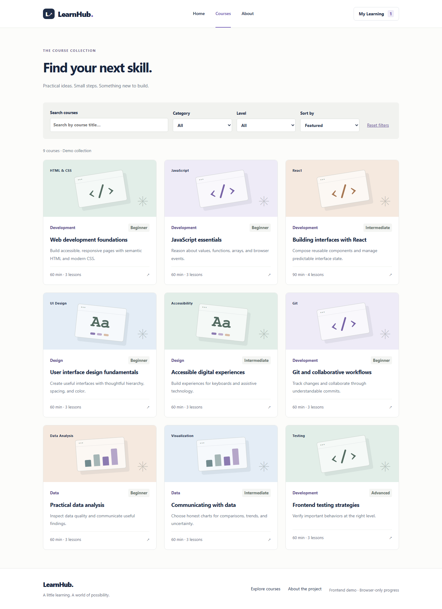
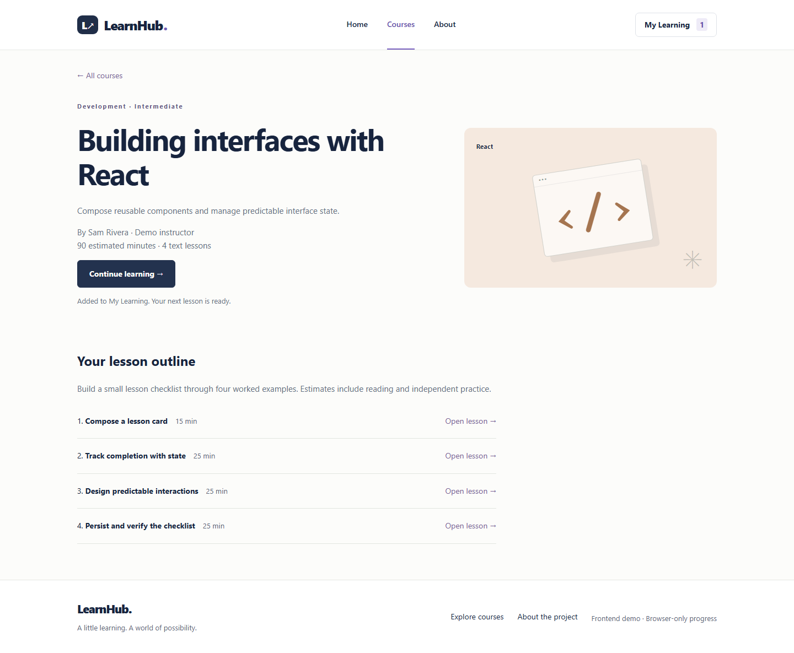
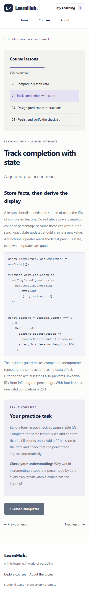
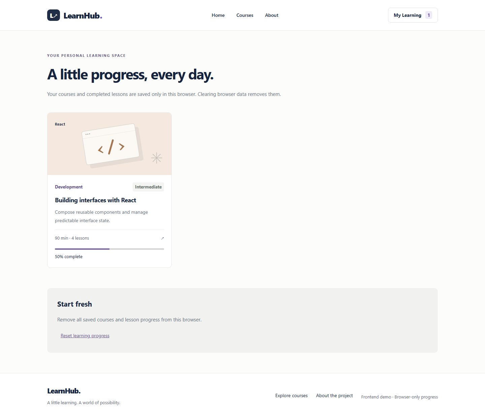

# LearnHub — Learning Platform Frontend

A React portfolio project demonstrating a complete browser-only learning journey: browse → filter → inspect a course → add it to My Learning → read lessons → complete them → restore progress after reload.

This is a frontend demonstration, not a production LMS. The nine courses and instructors are fictional demo content. The React course contains four worked lessons building a small checklist; the other courses remain introductory samples. Estimates include reading and independent practice.



## Run locally

Use **Node.js 22.12 or newer** and npm.

```sh
npm ci
npm run dev
```

Open the URL printed by Vite. Explore the catalog, search for React, open **Building interfaces with React**, and select **Add to My Learning**. Work through the four lessons, mark them complete, and revisit the details page to see **Course completed** and **Review lessons**.

## Checks and browser setup

```sh
npm run lint
npm test
npm run test:install
npm run test:e2e
npm run build
```

`test:install` explicitly installs the Chromium build selected by the locked Playwright version. On Linux, install browser system dependencies with `npx playwright install --with-deps chromium` instead. System Edge or Chrome is not required. Browser tests start their own loopback Vite server on port 5175, fail if the port is occupied, and stop the server afterward. GitHub Actions installs Chromium and its dependencies on Ubuntu before running the same checks. The setup follows [Playwright's browser installation guidance](https://playwright.dev/docs/browsers).

Other commands:

```sh
npm run screenshots
npm run preview
npm run format
```

### What each verification does

- **Unit tests:** pure catalog URL parsing, reset serialization, search/filter/sort behavior, enrollment, repeat completion, valid progress, empty courses, duration totals, and persistence validation.
- **Behavioral browser tests:** observable controls, URLs, Back/Forward, shared URLs, reset/reload, complete three- and four-lesson journeys, exact keyboard focus targets, completed-course review, corrupt storage, failed writes with continued in-memory learning, and invalid routes. Every scenario runs at desktop (1440×1000) and mobile (390×844) sizes.
- **Screenshot captures:** `npm run screenshots` uses a separate configuration and writes five actual pages at both sizes to `docs/screenshots/`. Capture readiness checks ensure the intended page loaded. These captures support human inspection; they are not counted as behavioral regression scenarios.
- **Visual regression tests:** no automated pixel-baseline comparison is implemented. Screenshot capture alone does not prove visual equivalence. The included captures are manually inspected for clipping, overflow, spacing, and readability.

## Implemented features

- Home, catalog, details, My Learning, text lessons, About, and 404 pages.
- Nine demo courses, title search, category and level filters, title/duration sorting, empty state, and reset.
- Shareable filters and reliable reload/Back/Forward behavior.
- Duplicate-safe enrollment and completion. Counts, navigation boundaries, duration totals, and progress derive from course data.
- Four worked React lessons with code examples, practice tasks, and understanding checks.
- Completion state with a review action after every lesson is done.
- Browser persistence with malformed-data recovery and a visible warning when saving fails; learning continues in memory.
- Reset confirmation defaults keyboard focus to Cancel, restores the trigger on cancellation, and focuses the empty-state heading after confirmation.
- Visible keyboard focus, labels, semantic navigation, a skip link, route-change focus, and native progress elements.
- Consistent navy/purple design, readable supporting text, and distinct development, design, and data artwork built with CSS.

## URL and history decisions

`/courses?search=interface&category=Design&level=Beginner&sort=title` reproduces the same controls and result after refresh or in another browser tab. The URL is the source of truth; no second filter state is kept in the component.

Select changes and reset **push** a history entry. Search typing **replaces** the current entry immediately, so results and a copied URL stay current without creating one Back step per character. Back returns to the preceding deliberate selection or page; it does not undo individual keystrokes. Forward restores the final search in that entry. Reset removes the four filter parameters, preserving unrelated query parameters. Default values are omitted when writing the URL. Unknown enum values behave as defaults and are normalized on the next filter change; they never leave a select with an invalid value.

## Architecture and interview guide

| Location                                                 | Responsibility                                                                         |
| -------------------------------------------------------- | -------------------------------------------------------------------------------------- |
| `src/App.jsx`                                            | Routes, the single shared learning state, storage warning, and route-change focus      |
| `src/pages/Catalog.jsx` / `src/state/catalog.js`         | URL-driven filters, validation, serialization, history policy                          |
| `src/pages/Details.jsx`                                  | Enrollment focus, next unfinished lesson, completed-course review, empty outline guard |
| `src/pages/Lesson.jsx`                                   | Data-derived navigation, reading content, completion, and direct-enrollment focus      |
| `src/pages/Learning.jsx`                                 | Saved courses and deliberate reset with focus restoration                              |
| `src/components/`                                        | Course cards, category artwork, and missing-page state                                 |
| `src/data/courses.js`, `practice.js`, `react-lessons.js` | Course metadata and explicit lesson content and minute estimates                       |
| `src/data/course-utils.js`                               | Course duration as a sum of lesson estimates                                           |
| `src/state/learning.js`                                  | Validation, persistence, enrollment, completion, and progress                          |
| `src/index.css`                                          | Shared visual identity, responsive layouts, readable controls and metadata             |
| `tests/` / `e2e/`                                        | Pure-rule tests and observable browser regressions                                     |
| `e2e/captures/`                                          | Documentation captures, separate from behavioral tests                                 |
| `docs/dependency-review.md`                              | Dependency evidence, migration assessment, remaining findings                          |

The stored shape maps course IDs to completed lesson ID arrays. A present course key means enrollment, even if its array is empty. Completion is idempotent. Progress is the number of valid completed lessons divided by actual lesson count, rounded for display; empty courses return 0%. Durations are summed from each lesson's explicit `minutes` field. Unknown IDs and duplicate stored completions are discarded. Existing lesson IDs were retained when enriching the React course; learners who had completed the old three lessons now see 75% because a fourth lesson is available.

Focus effects run only when an action requests a focus move. Initial page navigation still focuses the main region. Details enrollment focuses the next action; direct lesson enrollment focuses the revealed heading. Enrollment copy does not also announce a duplicate live status. Lesson progress uses one polite status; failed storage uses one persistent alert.

React state is sufficient for this scope. React Router uses lowercase browser routes with `/` as home. The earlier foundation pass removed unused Redux, network fetching, and unrelated News/Students/Teachers pages. Original source and history remain in Git. This refinement preserves that architecture.

Interview prompts:

1. Why should the URL own filter state? What does replace versus push mean for Back?
2. Why derive progress and duration instead of storing redundant totals?
3. How do refs and post-render effects preserve focus when a control disappears?
4. What changes when browser storage is unavailable or a new lesson is added?
5. Why are unit assertions, browser behavior, and visual comparisons different checks?

## Screenshots

Actual documentation captures are in `docs/screenshots/`. The catalog above shows the collection; these views illustrate the learning journey:







The capture command also records mobile catalog/details/My Learning and desktop lessons, plus both home layouts. It seeds its own isolated browser context with 50% React progress for repeatable documentation images.

## Deployment preparation

Nothing is deployed. Build with `npm run build`; publish **dist** at the site root.

- **Netlify:** build `npm run build`, publish `dist`. `public/_redirects` provides the single-page route fallback.
- **Vercel:** choose Vite with output `dist`; `vercel.json` rewrites client routes to `index.html`.
- **Other static hosts:** return `index.html` for application routes and serve real assets normally. Check direct visits to `/courses/react` and `/learn/react/foundations`.
- GitHub Pages project-subdirectory hosting needs additional base-path and routing configuration.

## Dependency review and limitations

The dated [dependency review](docs/dependency-review.md) records versions, official compatibility guidance, the isolated Vite 4 → 7.3 migration, and live before/after audit results. The final audit has **two moderate React Router package entries**. The current app does not expose attacker-supplied navigation destinations and does not use SSR hydration; this is a code-specific impact assessment, not a vulnerability-free claim. A separately reviewed Router 7.18+ migration is recommended before publication.

Progress belongs to one browser and origin, without cross-tab/device synchronization. Clearing data removes it; writes can fail, in which case changes last for the current visit. There are no accounts, backend services, payments, certificates, or grading. Content remains a demonstration. Automated browser checks cover Chromium, not Firefox, WebKit, or physical mobile devices, and do not replace assistive-technology testing.

A future backend phase could add validated course APIs, real identity, server-side authorization, enrollment/progress storage, and cross-device synchronization. Define those contracts before adding accounts.

## Attribution

Based on [sirenaGh/task5](https://github.com/sirenaGh/task5), preserving its Git history. The LearnHub implementation and this refinement used OpenAI Codex assistance; they should not be presented as entirely unaided work. Review the code and understand the design decisions before discussing the project in interviews.

Artwork is original HTML/CSS. No third-party photos, remote fonts, broken videos, fabricated testimonials, or user counts are used. Dependencies retain their own licenses. The original repository has no project license; choose one before granting reuse rights.

## Manual review checklist

1. Open `/courses?category=Design`, reset, reload, then use Back and Forward.
2. Share a URL with search, category, level, and sort; confirm another tab matches.
3. Use the keyboard to enroll from details and a direct lesson URL; inspect focus.
4. Open reset, cancel, reopen, and confirm; inspect focus after every step.
5. Complete all four React lessons, reload details, and use Review lessons.
6. Check catalog, lesson code, and My Learning at narrow and desktop widths.
7. Read the dependency findings and repeat the live audit before publication.

## Verified results (2026-10-15)

| Command / check                                                                               | Result                                                                     |
| --------------------------------------------------------------------------------------------- | -------------------------------------------------------------------------- |
| `npm run lint`                                                                                | Passed, zero warnings                                                      |
| `npm test`                                                                                    | 8 unit tests passed                                                        |
| `npm run test:install`                                                                        | Installed the locked Playwright Chromium build successfully                |
| `npm run test:e2e`                                                                            | 20 behavioral checks passed: 10 scenarios × 2 viewport sizes               |
| `npm run build`                                                                               | Production build passed with Vite 7.3.7                                    |
| `npm run screenshots`                                                                         | 10 documentation captures created: 5 pages × 2 sizes; no pixel comparisons |
| Live `npm audit --json --offline=false --prefer-online --registry=https://registry.npmjs.org` | 2 moderate router package entries remain; impact and next steps documented |

The catalog, details, lesson, and My Learning captures were visually inspected at desktop and mobile sizes. Text and code wrap within the layout; no clipping or page overflow was observed in those captures. This is human review of specific states, not an automated visual-regression guarantee. The workflow is prepared but has not run on GitHub. No public deployment, Firefox/WebKit run, physical-device testing, or full screen-reader audit was performed.
